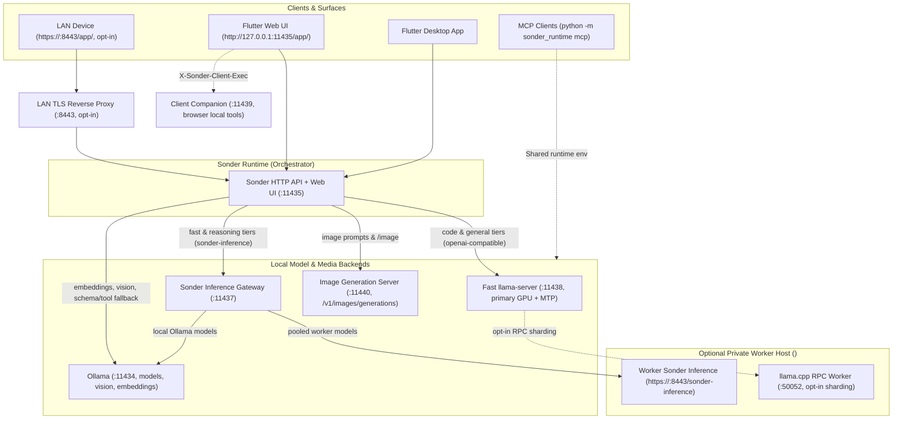
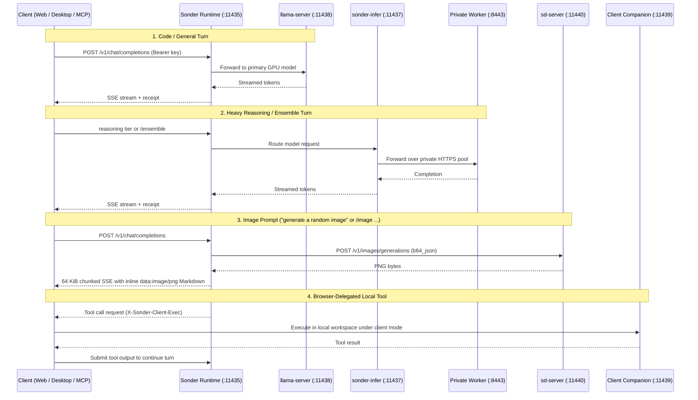

# Local & Multi-Server Stack Guide

How all the optional and core local servers in a full Sonder Runtime deployment fit together, why each process exists, what ports and environment variables wire them together, and how to stand up the stack cleanly.

> **Related runbooks:** [setup-start-here.md](setup-start-here.md) · [install-workstation-local.md](install-workstation-local.md) · [sonder-inference.md](sonder-inference.md) · [rpc-sharding.md](rpc-sharding.md) · [multi-pc-ollama.md](multi-pc-ollama.md) · [configure-authentication.md](configure-authentication.md) · [secure-remote-access.md](secure-remote-access.md)

---

## 1. Why Multiple Servers?

Sonder Runtime is a **local-first orchestration layer**, not a monolithic model runner. Separating inference, image synthesis, browser tool delegation, and TLS termination into dedicated loopback services solves four practical constraints:

1. **GPU VRAM isolation:** A full-VRAM coding/chat LLM typically occupies most of a primary discrete GPU. Running diffusion image generation on a secondary GPU / integrated GPU (or offloaded to CPU) and heavy reasoning models on an optional private worker host prevents constant model evictions and out-of-memory failures.
2. **Throughput vs. flexibility:** A dedicated `llama-server` instance provides FlashAttention, quantized KV caches, and native speculative decoding (MTP) on one primary model, while `sonder-infer` + Ollama handle multi-model routing, lazy loading, embeddings, vision, and cross-host pooling.
3. **Browser sandbox boundary:** The Flutter Web UI cannot execute workspace tools directly in the browser. A dedicated loopback **Client Companion** (`sonder_runtime.interfaces.client_agent`) bridges browser-delegated tool execution under your own client-local permission mode.
4. **Defense in depth:** All core services bind strictly to `127.0.0.1`. Remote phone/LAN access only enters through an explicit TLS reverse proxy, and private worker pooling uses explicit opt-in over HTTPS with pinned CA bundles and per-worker bearer tokens.



---

## 2. Standard Port Map

All local services bind to `127.0.0.1` by default. Only an explicit TLS reverse proxy binds to a LAN interface.

| Default Port | Service | Entrypoint / Binary | Primary Role | Typical Hardware |
|---|---|---|---|---|
| `127.0.0.1:11434` | **Ollama** | `ollama serve` | Local model store, embeddings, vision, lazy backend for `sonder-infer`, structured/tool fallback | Primary GPU / RAM |
| `127.0.0.1:11435` | **Sonder Runtime HTTP + Web UI** | `python -m sonder_runtime serve` | OpenAI-compatible API, `/app/` Flutter Web UI, routing, memory, approvals, agent lanes, image routing | CPU |
| `127.0.0.1:11437` | **Sonder Inference Gateway** | `sonder-infer serve` | Streaming inference gateway (`api_version 1`), multi-model registry, private worker pooling | Proxies Ollama + workers |
| `127.0.0.1:11438` | **Fast `llama-server`** *(optional)* | `llama-server` | High-throughput single-model OpenAI-compatible server (FlashAttention, quantized KV cache, MTP) | Primary discrete GPU |
| `127.0.0.1:11439` | **Sonder Client Companion** *(optional)* | `python -m sonder_runtime.interfaces.client_agent` | Browser-delegated local workspace tool execution (`X-Sonder-Client-Exec: 1`) | CPU |
| `127.0.0.1:11440` | **Local Image Server** *(optional)* | `sd-server` (`stable-diffusion.cpp`) or any OpenAI-compatible `/v1/images/generations` server | Local diffusion image generation routed directly into inline chat cards | Secondary GPU / iGPU (Vulkan) or CPU offload |
| `<lan-ip>:8443` | **LAN TLS Reverse Proxy** *(optional)* | TLS proxy (e.g. Caddy or local TLS forwarder) | Terminates HTTPS for phone/tablet access to `:11435` | CPU |
| `<worker-ip>:8443` | **Private Worker Inference** *(optional)* | Remote `sonder-infer` behind HTTPS | Offloads large reasoning/ensemble models to a second machine over a private link | Worker host RAM / GPU |
| `<worker-ip>:50052` | **llama.cpp RPC Worker** *(optional)* | `rpc-server` | Opt-in layer sharding for models larger than one host (see [rpc-sharding.md](rpc-sharding.md)) | Worker host GPU / RAM |

> **Port collision note:** Port `11439` is the standard default for the **Client Companion** (`client_agent`). Keep any local image generation server on a separate loopback port such as `11440`.

---

## 3. How Each Server Hooks Into Sonder

### 3.1 Sonder Runtime (`127.0.0.1:11435`)

Sonder Runtime exposes both the HTTP API (`/v1/chat/completions`, `/v1/models`, `/v1/responses`, `/v1/permission-mode`, `/v1/approvals`, `/v1/agent-lanes`, `/v1/background-work`, `/health`, `/v1/sonder/status`) and the built Flutter Web UI at `/app/`.

**Authentication & permission modes:**
- **Unauthenticated loopback (`local-open`):** Convenient for read-only chat, but intentionally caps permission modes at `manual` / `plan` and refuses HTTP `auto` mode and unattended approvals.
- **Authenticated loopback (`api-key`, recommended for daily local use):**
  ```bash
  export SONDER_API_KEY="<high-entropy-local-key>"
  export SONDER_REQUIRE_ACCOUNT=0
  export SONDER_WEB_APP=1
  python -m sonder_runtime serve \
    --set server.host=127.0.0.1 \
    --set server.port=11435 \
    --set server.auth_mode=api-key \
    --set server.tls_terminated_by_proxy=false \
    --set server.web_app_enabled=true
  ```
  This unlocks `auto` permission mode, one-click and bulk Approvals (`Approve all`, `Deny all`, `Revoke all`), and bulk clearing of finished agent lanes/background runs without requiring a hosted account login.
- **Multi-device LAN (`both` behind a TLS proxy):** Set `server.auth_mode=both`, `server.tls_terminated_by_proxy=true`, `SONDER_ALLOWED_HOSTS`, `SONDER_ALLOWED_ORIGINS`, and `SONDER_CORS_ORIGINS` (see [secure-remote-access.md](secure-remote-access.md)).

**Serving updated Flutter Web builds:**
Sonder serves `/app/` from `<sonder-home>/web_app/releases/<release-id>` pointed to by `<sonder-home>/web_app/current.json` (`{"release": "<release-id>"}`). After running `flutter build web --release --base-href /app/`, copy `app/build/web/*` into a new release directory and update `current.json`.

### 3.2 Ollama (`127.0.0.1:11434`)

Even when primary generation runs through `sonder-infer` or `llama-server`, Ollama remains the core local foundation for:
- **Embeddings:** `SONDER_EMBEDDING_PROVIDER=ollama` + `SONDER_EMBED_MODEL=nomic-embed-text:latest`
- **Vision:** `SONDER_VISION_PROVIDER=ollama` + `SONDER_VISION=<vision-model>` (for `vision_analyze` and visual inspection)
- **Fallback & structured steps:** `SONDER_INFERENCE_FALLBACK=ollama` handles pre-send outages and schema/tool steps that an inference gateway delegates back to Ollama
- **Ollama-native image-model discovery:** On platforms where Ollama supports image generation models natively (e.g., `x/z-image-turbo`, `x/flux2-klein`), Sonder automatically discovers them from `/api/tags`.

```bash
export OLLAMA_HOST="http://127.0.0.1:11434"
export SONDER_EMBEDDING_PROVIDER="ollama"
export SONDER_EMBED_MODEL="nomic-embed-text:latest"
export SONDER_VISION_PROVIDER="ollama"
export SONDER_VISION="<vision-model>"
export SONDER_INFERENCE_FALLBACK="ollama"
```

### 3.3 Sonder Inference Gateway (`127.0.0.1:11437`)

`sonder-infer` sits in front of Ollama (and optional private worker peers) and exposes `/v1/sonder/health` and OpenAI-compatible streaming endpoints.

```bash
sonder-infer serve \
  --backend ollama \
  --ollama-url http://127.0.0.1:11434 \
  --port 11437 \
  --lazy-models \
  --model <general-model> \
  --model <fast-model> \
  --model <reasoning-model>
```

Wire Sonder Runtime to it via:
```bash
export SONDER_MODEL_BACKEND="sonder-inference"
export SONDER_INFERENCE_BASE_URL="http://127.0.0.1:11437"
export SONDER_INFERENCE_MODEL="<general-model>"
export SONDER_INFERENCE_TIER_MODELS="fast=<fast-model>,code=<code-model>,general=<general-model>,reasoning=<reasoning-model>"
export SONDER_INFERENCE_THINKING="on"
```

To pool an additional private worker host running `sonder-infer` behind HTTPS (strictly opt-in; never enables cloud tiers):
```bash
export SONDER_ALLOW_REMOTE_INFERENCE="1"
export SONDER_INFERENCE_WORKER_TOKEN="<worker-bearer-token>"
export SONDER_INFERENCE_PRIVATE_WORKERS='[{"url":"https://<worker-ip>:8443/sonder-inference","ca_bundle":"<path-to-ca-bundle.pem>","token_env":"SONDER_INFERENCE_WORKER_TOKEN","max_inflight":1}]'
```

### 3.4 Fast Local `llama-server` (`127.0.0.1:11438`, optional)

When you want maximum single-model throughput on your primary discrete GPU (FlashAttention, quantized KV cache, native MTP speculative decoding), run `llama-server` bound strictly to loopback:

```bash
llama-server \
  --model "<path-to-model.gguf>" \
  --alias "<model-alias>" \
  --host 127.0.0.1 \
  --port 11438 \
  --ctx-size 16384 \
  --n-gpu-layers 999 \
  --flash-attn on \
  --cache-type-k q8_0 \
  --cache-type-v q8_0 \
  --parallel 1 \
  --no-webui \
  --spec-type draft-mtp \
  --spec-draft-n-max 3
```

Bind Sonder's primary `code` and `general` tiers to `:11438` while keeping `fast` and `reasoning` on `sonder-inference` (`:11437` / private worker) so reasoning queries do not evict your primary GPU model:

```bash
export SONDER_CODE_PROVIDER="openai-compatible"
export SONDER_GENERAL_PROVIDER="openai-compatible"
export SONDER_FAST_PROVIDER="sonder-inference"
export SONDER_REASONING_PROVIDER="sonder-inference"
export SONDER_OPENAI_BASE_URL="http://127.0.0.1:11438"
export SONDER_OPENAI_MODEL="<model-alias>"
```

When `:11438` is not running, point all four `*_PROVIDER` variables back to `sonder-inference` (or let a launcher script probe `http://127.0.0.1:11438/health` at startup and fall back automatically).

### 3.5 Client Companion (`127.0.0.1:11439`, optional for Web UI tools)

To let the Flutter Web UI run workspace tools locally under your client-local permission mode:

```bash
export SONDER_CLIENT_AGENT_TOKEN="<high-entropy-companion-token>"
export SONDER_CLIENT_AGENT_ALLOWED_ORIGINS="http://127.0.0.1:11435,http://localhost:11435"
python -m sonder_runtime.interfaces.client_agent \
  --host 127.0.0.1 \
  --port 11439 \
  --workspace "<local-workspace-dir>" \
  --mode manual
```

### 3.6 Local Image Generation Server (`127.0.0.1:11440`, optional)

Sonder includes dedicated chat image routing (`sonder_runtime/application/image_generation.py`, `intents.classify_image_generation`, and `/image <prompt>`). It resolves image backends in strict priority order:

1. **OpenAI-compatible Image API (`SONDER_IMAGE_API_URL`):** Loopback HTTP or remote HTTPS endpoint implementing `POST /v1/images/generations` (`response_format: "b64_json"`).
2. **Explicit image model (`SONDER_IMAGE_MODEL` or selecting an image model directly in chat):** Routed to the configured image API or Ollama `/api/generate`.
3. **Auto-discovered Ollama image models:** Scans `/api/tags` for image-generation models (`z-image`, `flux`, `sdxl`, `stable-diffusion`, `sd3`, `diffusion`, etc., excluding image-to-text vision models like `-vl`, `llava`, `moondream`).
4. **Built-in instant fallback (`sonder-assetgen`):** Pure-Python procedural PNG synthesis so chat still renders an inline PNG immediately if no diffusion backend is active.

**Recommended cross-platform local setup (`stable-diffusion.cpp` `sd-server`):**
Because Ollama's experimental image runner currently requires Apple MLX on macOS, Windows and Linux hosts can run `sd-server` (from `stable-diffusion.cpp`) with a fast single-file checkpoint such as SDXL-Turbo FP16:

```bash
# List available Vulkan / CUDA / CPU devices first:
sd-server --list-devices

# Start sd-server on a secondary GPU / iGPU (e.g. vulkan1) with CPU offload
# so primary discrete GPU VRAM stays dedicated to LLM inference:
sd-server \
  --listen-ip 127.0.0.1 \
  --listen-port 11440 \
  -m "<models-dir>/sd_xl_turbo_1.0_fp16.safetensors" \
  --backend vulkan1 \
  --offload-to-cpu \
  --vae-tiling \
  --steps 4 \
  --cfg-scale 1.0 \
  --sampling-method euler_a \
  -W 512 -H 512
```

Wire Sonder Runtime to it via:
```bash
export SONDER_IMAGE_API_URL="http://127.0.0.1:11440"
export SONDER_IMAGE_MODEL="sdxl-turbo"
# Optional if your image server requires bearer auth:
# export SONDER_IMAGE_API_KEY="<token>"
```

**How inline chat image delivery works:**
- Generated images are saved to `<sonder-home>/generated-images/`.
- Payloads are kept within the app's inline data-URI budget (`<= 1.5 MB` raw, comfortably under Flutter's `2 MiB` `markdownDataImageMaxBytes` cap).
- Streamed responses slice large content payloads into `64 KiB` SSE frames (`sonder_runtime/interfaces/http/live_stream.py`) so inline base64 PNGs never exceed the client's `1 MiB` SSE line-length guard.
- The Flutter UI renders inline `data:image/...` Markdown inside a framed card with click-to-zoom lightbox and one-click Copy for pasting into chat (both assistant and user chat bubbles render inline `data:image/` Markdown images).

---

## 4. End-to-End Request Flows



---

## 5. Recommended Startup Order & Health Checks

Start dependencies from the bottom up so Sonder detects live fast/image backends at boot:

1. **Ollama** (`http://127.0.0.1:11434/api/version`)
2. **Fast `llama-server`** *(optional)* (`http://127.0.0.1:11438/health` -> `{"status":"ok"}`)
3. **Sonder Inference Gateway** (`http://127.0.0.1:11437/v1/sonder/health` -> `status: ready`)
4. **Local Image Server** *(optional)* (`127.0.0.1:11440` listening)
5. **Client Companion** *(optional, for Web UI local tools)* (`http://127.0.0.1:11439/health`)
6. **Sonder Runtime HTTP + Web UI** (`http://127.0.0.1:11435/health` -> HTTP `200`, UI at `http://127.0.0.1:11435/app/`)
7. **LAN TLS Proxy** *(optional)* (`https://<lan-ip>:8443/app/`)

Run the built-in read-only health check at any time:
```bash
python -m sonder_runtime doctor
```

---

## 6. Common Troubleshooting

| Symptom | Cause | Fix |
|---|---|---|
| `auto` permission mode snaps back to `manual` | `:11435` started with `local-open` (unauthenticated) auth mode | Start with `server.auth_mode=api-key` and `SONDER_API_KEY` set |
| Image prompts use `sonder-assetgen` fallback instead of diffusion | `:11440` (`sd-server`) is not listening or `SONDER_IMAGE_API_URL` is unset | Start `sd-server` on `127.0.0.1:11440`, export `SONDER_IMAGE_API_URL=http://127.0.0.1:11440`, and restart `:11435` |
| Ollama image model fails on Windows/Linux with MLX error | Ollama's experimental `x/*` image models currently require Apple MLX | Use `sd-server` (`stable-diffusion.cpp`) via `SONDER_IMAGE_API_URL` instead |
| Web UI does not reflect a fresh `flutter build web` | `:11435` serves `<sonder-home>/web_app/releases/<current>` via `current.json` | Copy `app/build/web/*` into a new release folder and update `current.json` |
| Primary GPU VRAM contention after vision calls | Ollama kept the vision model resident alongside `llama-server` | Unload the vision model (`ollama stop <vision-model>`) after vision tasks |
| Port conflict on `:11439` | Client Companion already owns `11439` | Run the image server on `11440` (or another free loopback port) |

---

## 7. Security Models and Tool-Lane Policy

By default, the shipped `security-advisers` floor in `sonder_runtime/adapters/data/model_tool_policy.json` keeps security-tuned / red-team adviser models (such as `astra-cyber-*`) chat-only and prevents them from driving tool-using lanes or binding to a tier.

If you want a security model to inspect code or drive tools in your own environment, choose one of two explicit opt-ins:

### Option A — Read-Only Project Tools via Operator Overlay (Recommended)

Keep the `security-advisers` floor intact and grant only read-only workspace inspection tools from the shipped `restricted_tool_ceiling` (`text_search`, `repository_symbol_index`, `file_read_range`, `directory_tree`, `context_pack`) in `agent` / `workbench_agent` lanes via the console editor:

```text
/runtime tools allow astra-cyber-* text_search agent
/runtime tools allow astra-cyber-* file_read_range agent
/runtime tools allow astra-cyber-* directory_tree agent
```

Write/shell tools remain blocked and secret path globs stay enforced.

### Option B — Full Tool Access via Explicit Host Opt-In (Intentionally Weakens Model-Name Floor)

To allow security models to bind to the optional `security` tier (`SONDER_SECURITY=<model>`) and drive Sonder's full tool set, set the exact acknowledgement value in the **host process environment** before starting Sonder:

```bash
export SONDER_ALLOW_SECURITY_MODEL_TOOLS="I_ACCEPT_SECURITY_MODEL_TOOL_RISK"
export SONDER_SECURITY="<security-model>"
```

**Guardrails that remain in force:**
- **Off by default and fail-closed:** Unset values and casual truthy shorthand (`1`, `true`, `yes`) are rejected and logged; only the exact acknowledgement string activates relaxation.
- **Host-environment only:** Cannot be set from `runtime_policy.json`, HTTP APIs, MCP tools, or chat.
- **Narrow scope:** Relaxes *only* the shipped `security-advisers` model-name floor. Permission modes (`manual`/`auto`), approval prompts, workspace containment, secret redaction, shipped policy SHA-256 tamper pinning, `undetermined_served_models`, other shipped floors, and any explicit operator overlay denials all remain enforced.
- **Never silent:** Logs a `WARNING` at activation and displays an explicit `WARNING` line in `/runtime status` and `/runtime tools`.
