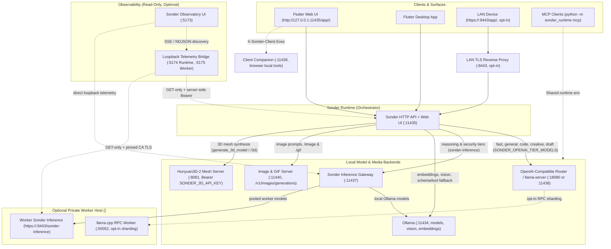
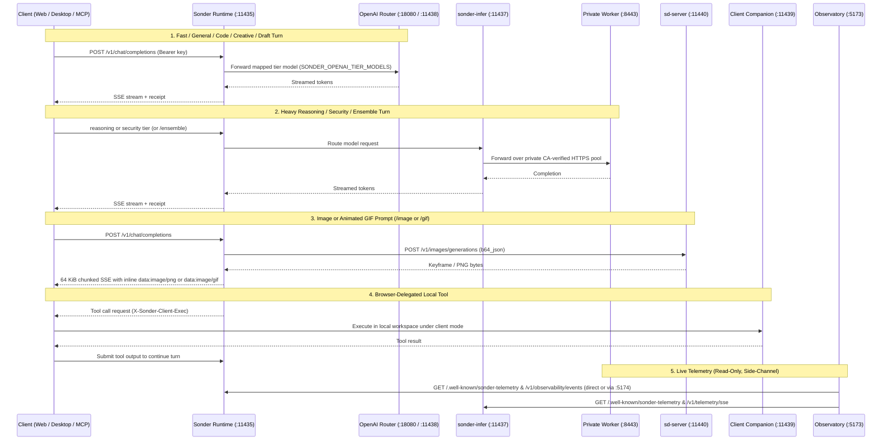

# Local & Multi-Server Stack Guide

How all the core and optional local servers in a full Sonder Runtime deployment fit together, why each process exists, what ports and environment variables wire them together, and how to stand up and observe the stack cleanly.

> **Related runbooks:** [setup-start-here.md](setup-start-here.md) · [install-workstation-local.md](install-workstation-local.md) · [sonder-inference.md](sonder-inference.md) · [rpc-sharding.md](rpc-sharding.md) · [multi-pc-ollama.md](multi-pc-ollama.md) · [configure-authentication.md](configure-authentication.md) · [secure-remote-access.md](secure-remote-access.md)

---

## 1. Why Multiple Servers?

Sonder Runtime is a **local-first orchestration layer**, not a monolithic model runner. Separating inference, image/GIF synthesis, browser tool delegation, live observability, and TLS termination into dedicated loopback services solves four practical constraints:

1. **GPU VRAM isolation:** Primary coding and chat LLMs typically occupy most of a primary discrete GPU. Running diffusion image generation on a secondary GPU / integrated GPU (or disk-backed / CPU-offloaded) and heavy reasoning or security-specialist models on an optional private worker host prevents constant model evictions and out-of-memory failures.
2. **Throughput vs. flexibility:** A dedicated `llama-server` router (or single-model server) provides FlashAttention, quantized KV caches, native speculative decoding (MTP), and concurrent multi-model routing (`SONDER_OPENAI_TIER_MODELS`), while `sonder-infer` + Ollama handle lazy model loading, embeddings, vision, and cross-host worker pooling.
3. **Browser sandbox boundary:** The Flutter Web UI cannot execute workspace tools directly in the browser. A dedicated loopback **Client Companion** (`sonder_runtime.interfaces.client_agent`) bridges browser-delegated tool execution under your own client-local permission mode.
4. **Defense in depth:** All core services and observability endpoints bind strictly to `127.0.0.1`. Remote phone/LAN access only enters through an explicit TLS reverse proxy, private worker pooling uses explicit opt-in over HTTPS with pinned CA bundles and per-worker bearer tokens, and Sonder Observatory connects strictly read-only with route-scoped CORS (`SONDER_OBSERVATORY_ORIGINS`).



---

## 2. Standard Port Map

All local services bind to `127.0.0.1` by default. Only an explicit TLS reverse proxy binds to a LAN interface.

| Default Port | Service | Entrypoint / Binary | Primary Role | Typical Hardware |
|---|---|---|---|---|
| `127.0.0.1:11434` | **Ollama** | `ollama serve` | Local model store, embeddings, vision, lazy backend for `sonder-infer`, structured/tool fallback | Primary GPU / RAM |
| `127.0.0.1:11435` | **Sonder Runtime HTTP + Web UI** | `python -m sonder_runtime serve` | OpenAI-compatible API, `/app/` Flutter Web UI, 8-tier routing, memory, approvals, agent lanes, `/image` & `/gif`, `/v1/sonder/ecosystem` | CPU |
| `127.0.0.1:11437` | **Sonder Inference Gateway** | `sonder-infer serve` | Streaming inference gateway (`api_version 1`), multi-model registry, private worker pooling, live telemetry producer | Proxies Ollama + workers |
| `127.0.0.1:18080` | **Multi-Model OpenAI-Compatible Router** *(optional)* | `llama-server --models-preset ...` | Serves multiple local models concurrently on one loopback port (FlashAttention, quantized KV cache, MTP) wired via `SONDER_OPENAI_TIER_MODELS` | Primary discrete GPU |
| `127.0.0.1:11438` | **Single-Model Fast `llama-server`** *(optional fallback)* | `llama-server` | High-throughput single-model OpenAI-compatible server when not using a multi-model router | Primary discrete GPU |
| `127.0.0.1:11439` | **Sonder Client Companion** *(optional)* | `python -m sonder_runtime.interfaces.client_agent` | Browser-delegated local workspace tool execution (`X-Sonder-Client-Exec: 1`) | CPU |
| `127.0.0.1:11440` | **Local Image Server** *(optional)* | `sd-server` (`stable-diffusion.cpp`) or any OpenAI-compatible `/v1/images/generations` server | Local diffusion synthesis for `/image` and animated `/gif` keyframes routed into inline chat cards | Secondary GPU / integrated GPU (Vulkan) or CPU offload |
| `127.0.0.1:8081` | **Local Hunyuan3D-2 Server** *(optional)* | Hunyuan3D-2 API server (`D:\Applications\Hunyuan3D`, launched with `-NoText` when `:11440` handles concept synthesis) | Local 3D mesh (`.glb`/`.obj`) generation for `generate_3d_model` (authenticated with `SONDER_3D_API_KEY`, no wildcard CORS, bounded input & queue caps) | Primary discrete GPU (yields LLM VRAM during synthesis) |
| `127.0.0.1:5173` | **Sonder Observatory UI** *(optional)* | Static production bundle or Vite dev/preview server | Live read-only telemetry visualizer for Runtime and Inference producers | CPU (lightweight static server) |
| `127.0.0.1:5174`, `:5175` | **Observatory Telemetry Bridge** *(optional)* | Loopback GET-only telemetry forwarder | Injects server-side auth / pinned CA TLS for browser Observatory connections (`:5174` -> Runtime, `:5175` -> Worker) without exposing tokens to the browser | CPU |
| `<lan-ip>:8443` | **LAN TLS Reverse Proxy** *(optional)* | TLS proxy (e.g. Caddy or local TLS forwarder) | Terminates HTTPS for phone/tablet access to `:11435` | CPU |
| `<worker-ip>:8443` | **Private Worker Inference** *(optional)* | Remote `sonder-infer` behind HTTPS | Offloads heavy `reasoning`, `security`, or ensemble models to a second host over a private link | Worker host RAM / GPU |
| `<worker-ip>:50052` | **llama.cpp RPC Worker** *(optional)* | `rpc-server` | Opt-in layer sharding for models larger than one host (see [rpc-sharding.md](rpc-sharding.md)) | Worker host GPU / RAM |

> **Port collision note:** Port `11439` is the standard default for the **Client Companion** (`client_agent`). Keep any local image generation server on a separate loopback port such as `11440`, and avoid running `:18080` and `:11438` concurrently on the same primary GPU unless total VRAM fits both cleanly.

---

## 3. How Each Server Hooks Into Sonder

### 3.1 Sonder Runtime (`127.0.0.1:11435`) & The 8 Local Tiers

Sonder Runtime exposes both the HTTP API (`/v1/chat/completions`, `/v1/models`, `/v1/responses`, `/v1/permission-mode`, `/v1/approvals`, `/v1/agent-lanes`, `/v1/background-work`, `/health`, `/live`, `/v1/sonder/status`, `/v1/sonder/ecosystem`) and the built Flutter Web UI at `/app/`.

**Core tiers and 3 optional specialist tiers:**
Sonder supports **8 local model tiers** in `RuntimeModelConfiguration` (plus optional opt-in cloud tiers when `SONDER_ALLOW_CLOUD=1`):

| Tier | Model Env Var | Provider Override Env Var | Role |
|---|---|---|---|
| `fast` | `SONDER_FAST` | `SONDER_FAST_PROVIDER` | Low-latency routing, quick answers, lightweight edits |
| `general` | `SONDER_GENERAL` | `SONDER_GENERAL_PROVIDER` | Default everyday chat and synthesis |
| `code` | `SONDER_CODE` | `SONDER_CODE_PROVIDER` | Primary software engineering and tool-driven coding |
| `reasoning` *(optional)* | `SONDER_REASONING` | `SONDER_REASONING_PROVIDER` | Deep multi-step analysis (often offloaded to a private worker) |
| `vision` *(optional)* | `SONDER_VISION` | `SONDER_VISION_PROVIDER` | Image inspection and multimodal critique (typically Ollama) |
| `security` *(optional specialist)* | `SONDER_SECURITY` | `SONDER_SECURITY_PROVIDER` | Defensive security analysis, threat modeling, and audit tasks (see Section 7 for tool-lane policy) |
| `creative` *(optional specialist)* | `SONDER_CREATIVE` | `SONDER_CREATIVE_PROVIDER` | Long-form prose, narrative, ideation, and creative writing |
| `draft` *(optional specialist)* | `SONDER_DRAFT` | `SONDER_DRAFT_PROVIDER` | Ultra-fast speculative/draft helper and rapid scratchpad turns |

Unbound optional tiers fall back cleanly to general-purpose models so default single-model installs require zero extra configuration. When bound, all active tiers are advertised by `GET /v1/models` and reported with their resolved provider and served model in `GET /v1/sonder/ecosystem`.

**Authentication & permission modes:**
- **Unauthenticated loopback (`local-open`):** Convenient for read-only chat, but intentionally caps permission modes at `manual` / `plan` and refuses HTTP `auto` mode and unattended approvals.
- **Authenticated loopback (`api-key`, recommended for daily local use):**
  ```bash
  export SONDER_API_KEY="<high-entropy-local-key>"
  export SONDER_REQUIRE_ACCOUNT=0
  export SONDER_WEB_APP=1
  python -m sonder_runtime serve \
    --set server.host=127.0.0.1 \
    --set server.port=11435 \
    --set server.auth_mode=api-key \
    --set server.tls_terminated_by_proxy=false \
    --set server.web_app_enabled=true
  ```
  This unlocks `auto` permission mode, one-click and bulk Approvals (`Approve all`, `Deny all`, `Revoke all`), and bulk clearing of finished agent lanes/background runs without requiring a hosted account login.
- **Multi-device LAN (`both` behind a TLS proxy):** Set `server.auth_mode=both`, `server.tls_terminated_by_proxy=true`, `SONDER_ALLOWED_HOSTS`, `SONDER_ALLOWED_ORIGINS`, and `SONDER_CORS_ORIGINS` (see [secure-remote-access.md](secure-remote-access.md)).

**Serving updated Flutter Web builds:**
Sonder serves `/app/` from `<sonder-home>/web_app/releases/<release-id>` pointed to by `<sonder-home>/web_app/current.json` (`{"release": "<release-id>"}`). After running `flutter build web --release --base-href /app/`, copy `app/build/web/*` into a new release directory and update `current.json`.

### 3.2 Ollama (`127.0.0.1:11434`)

Even when primary generation runs through an OpenAI-compatible router or `sonder-infer`, Ollama remains the core local foundation for:
- **Embeddings:** `SONDER_EMBEDDING_PROVIDER=ollama` + `SONDER_EMBED_MODEL=nomic-embed-text:latest`
- **Vision:** `SONDER_VISION_PROVIDER=ollama` + `SONDER_VISION=<vision-model>` (for `vision_analyze` and visual inspection)
- **Fallback & structured steps:** `SONDER_INFERENCE_FALLBACK=ollama` handles pre-send outages and schema/tool steps that an inference gateway delegates back to Ollama
- **Ollama-native image-model discovery:** On platforms where Ollama supports image generation models natively (e.g., `x/z-image-turbo`, `x/flux2-klein`), Sonder automatically discovers them from `/api/tags`.

```bash
export OLLAMA_HOST="http://127.0.0.1:11434"
export SONDER_EMBEDDING_PROVIDER="ollama"
export SONDER_EMBED_MODEL="nomic-embed-text:latest"
export SONDER_VISION_PROVIDER="ollama"
export SONDER_VISION="<vision-model>"
export SONDER_INFERENCE_FALLBACK="ollama"
```

### 3.3 Sonder Inference Gateway (`127.0.0.1:11437`)

`sonder-infer` sits in front of Ollama (and optional private worker peers) and exposes `/v1/sonder/health`, `/.well-known/sonder-telemetry`, and OpenAI-compatible streaming endpoints.

```bash
sonder-infer serve \
  --backend ollama \
  --ollama-url http://127.0.0.1:11434 \
  --port 11437 \
  --lazy-models \
  --model <general-model> \
  --model <fast-model> \
  --model <reasoning-model> \
  --model <security-model>
```

Wire Sonder Runtime to it via:
```bash
export SONDER_MODEL_BACKEND="sonder-inference"
export SONDER_INFERENCE_BASE_URL="http://127.0.0.1:11437"
export SONDER_INFERENCE_MODEL="<general-model>"
export SONDER_INFERENCE_TIER_MODELS="fast=<fast-model>,code=<code-model>,general=<general-model>,reasoning=<reasoning-model>,security=<security-model>,creative=<creative-model>,draft=<draft-model>"
export SONDER_INFERENCE_THINKING="on"
```

To pool an additional private worker host running `sonder-infer` behind HTTPS (strictly opt-in; never enables cloud tiers):
```bash
export SONDER_ALLOW_REMOTE_INFERENCE="1"
export SONDER_INFERENCE_WORKER_TOKEN="<worker-bearer-token>"
export SONDER_INFERENCE_PRIVATE_WORKERS='[{"url":"https://<worker-ip>:8443/sonder-inference","ca_bundle":"<path-to-ca-bundle.pem>","token_env":"SONDER_INFERENCE_WORKER_TOKEN","max_inflight":1}]'
```

### 3.4 Multi-Model OpenAI-Compatible Routing (`SONDER_OPENAI_TIER_MODELS`) & Fast `llama-server`

When running an OpenAI-compatible multi-model router such as `llama-server` in preset-router mode (`127.0.0.1:18080`), you can keep both a fast low-latency model and a primary coding/general model resident in GPU VRAM simultaneously (plus smaller draft models loaded on demand) and map individual Sonder tiers to distinct model IDs on that single endpoint using **`SONDER_OPENAI_TIER_MODELS`**.

**Example `router-presets.ini`:**
```ini
version = 1

[*]
n-gpu-layers = 999
flash-attn = on
cache-type-k = q8_0
cache-type-v = q8_0
parallel = 1
reasoning = off

[fast-mtp]
model = <models-dir>/<fast-model>.gguf
ctx-size = 8192
spec-type = draft-mtp
spec-draft-n-max = 3

[primary-27b]
model = <models-dir>/<primary-model>.gguf
ctx-size = 16384

[draft-4b-mtp]
model = <models-dir>/<draft-model>.gguf
ctx-size = 8192
spec-type = draft-mtp
spec-draft-n-max = 3
```

**Start the loopback router:**
```bash
llama-server \
  --models-preset "<config-dir>/router-presets.ini" \
  --models-max 2 \
  --models-autoload \
  --host 127.0.0.1 \
  --port 18080 \
  --no-webui
```

**Wire Sonder tiers to the router via `SONDER_OPENAI_TIER_MODELS`:**
`SONDER_OPENAI_TIER_MODELS` takes comma-separated `tier=model` pairs (parsed by `openai_compat_gateway.parse_tier_models`). Any tier routed to `openai-compatible` looks up its mapped model ID first and falls back to `SONDER_OPENAI_MODEL` if unmapped:

```bash
export SONDER_OPENAI_BASE_URL="http://127.0.0.1:18080"
export SONDER_OPENAI_MODEL="primary-27b"
export SONDER_OPENAI_TIER_MODELS="fast=fast-mtp,general=primary-27b,code=primary-27b,creative=primary-27b,draft=draft-4b-mtp"

export SONDER_FAST_PROVIDER="openai-compatible"
export SONDER_GENERAL_PROVIDER="openai-compatible"
export SONDER_CODE_PROVIDER="openai-compatible"
export SONDER_CREATIVE_PROVIDER="openai-compatible"
export SONDER_DRAFT_PROVIDER="openai-compatible"

# Keep heavy reasoning & security specialists on sonder-inference (or a private worker)
# so primary GPU VRAM stays free of evictions:
export SONDER_REASONING_PROVIDER="sonder-inference"
export SONDER_SECURITY_PROVIDER="sonder-inference"
export SONDER_REASONING="<reasoning-model>"
export SONDER_SECURITY="<security-model>"
```

**Single-model fallback (`127.0.0.1:11438`):**
If you prefer a single-model `llama-server` instance instead of a multi-model router, bind it to `127.0.0.1:11438` (`--model <path-to-model.gguf> --alias <model-alias> --flash-attn on --cache-type-k q8_0 --cache-type-v q8_0 --spec-type draft-mtp --spec-draft-n-max 3`), point `SONDER_OPENAI_BASE_URL=http://127.0.0.1:11438` and `SONDER_OPENAI_MODEL=<model-alias>`, leave `SONDER_OPENAI_TIER_MODELS` unset, route `code` / `general` / `creative` to `openai-compatible`, and keep `fast` / `draft` / `reasoning` / `security` on `sonder-inference`. When neither `:18080` nor `:11438` is running, route all text tiers cleanly back to `sonder-inference`.

### 3.5 Client Companion (`127.0.0.1:11439`, optional for Web UI tools)

To let the Flutter Web UI run workspace tools locally under your client-local permission mode:

```bash
export SONDER_CLIENT_AGENT_TOKEN="<high-entropy-companion-token>"
export SONDER_CLIENT_AGENT_ALLOWED_ORIGINS="http://127.0.0.1:11435,http://localhost:11435"
python -m sonder_runtime.interfaces.client_agent \
  --host 127.0.0.1 \
  --port 11439 \
  --workspace "<local-workspace-dir>" \
  --mode manual
```

### 3.6 Local Image & Animated GIF Generation (`127.0.0.1:11440`, optional)

Sonder includes dedicated chat media routing (`sonder_runtime/application/image_generation.py`, `classify_gif_generation`, `classify_image_generation`, `/gif <prompt>`, and `/image <prompt>`). Image backends resolve in strict priority order:

1. **OpenAI-compatible Image API (`SONDER_IMAGE_API_URL`):** Loopback HTTP or remote HTTPS endpoint implementing `POST /v1/images/generations` (`response_format: "b64_json"`).
2. **Explicit image model (`SONDER_IMAGE_MODEL` or selecting an image model directly in chat):** Routed to the configured image API or Ollama `/api/generate`.
3. **Auto-discovered Ollama image models:** Scans `/api/tags` for image-generation models (`z-image`, `flux`, `sdxl`, `stable-diffusion`, `sd3`, `diffusion`, etc., excluding image-to-text vision models like `-vl`, `llava`, `moondream`).
4. **Built-in instant fallback (`sonder-assetgen`):** Pure-Python procedural PNG (for `/image`) or animated GIF89a (for `/gif`) synthesis so chat renders inline media immediately even if no diffusion backend is active.

**Recommended cross-platform local setup (`stable-diffusion.cpp` `sd-server`):**
Because Ollama's experimental image runner currently requires Apple MLX on macOS, Windows and Linux hosts can run `sd-server` (from `stable-diffusion.cpp`) with a fast single-file checkpoint such as SDXL-Turbo quantized to `q8_0` at load time and bounded to a secondary GPU / integrated GPU so primary LLM VRAM stays untouched:

```bash
# List available Vulkan / CUDA / CPU devices first:
sd-server --list-devices

# Start sd-server on a secondary GPU / integrated GPU (e.g. vulkan1) with q8_0
# weight quantization, mmap/disk-backed params, and a strict VRAM budget:
sd-server \
  --listen-ip 127.0.0.1 \
  --listen-port 11440 \
  -m "<models-dir>/sd_xl_turbo_1.0_fp16.safetensors" \
  --type q8_0 \
  --backend vulkan1 \
  --params-backend disk \
  --max-vram vulkan1=4 \
  --disable-prefetch \
  --mmap \
  --vae-tiling \
  --steps 4 \
  --cfg-scale 1.0 \
  --sampling-method euler_a \
  -W 512 -H 512
```

Wire Sonder Runtime to it via:
```bash
export SONDER_IMAGE_API_URL="http://127.0.0.1:11440"
export SONDER_IMAGE_MODEL="sdxl-turbo"
# Optional if your image server requires bearer auth:
# export SONDER_IMAGE_API_KEY="<token>"
```

**Animated GIF generation (`/gif`):**
- Triggered by `/gif <prompt>` or natural-language requests such as `"generate a gif of ..."` / `"create an animated gif ..."` via `classify_gif_generation` (checked ahead of `classify_image_generation`, while intentionally ignoring code or CLI conversion questions like `"how do I convert mp4 to gif in ffmpeg?"`).
- Handled by `generate_chat_gif` in `sonder_runtime/application/image_generation.py`:
  - When `SONDER_IMAGE_API_URL` and Pillow (`PIL.Image`) are available, generates a keyframe through the configured image API and synthesizes a seamless looping multi-frame GIF89a (smooth pan/zoom and subtle lighting/color motion, quantized and optimized).
  - When no diffusion backend or Pillow is installed, falls back cleanly to a multi-frame procedural animated GIF89a with zero external crash.
- Saves `.gif` files alongside still images under `<sonder-home>/generated-images/`, keeps payloads strictly under the inline data-URI budget (`MAX_INLINE_IMAGE_BYTES = 1,500,000` bytes raw), streams them in `64 KiB` SSE frames (as inline `data:image/gif;base64,...` Markdown images), and strips inline data URIs cleanly from conversation history via `strip_inline_data_images()`.

**How inline chat image & GIF delivery works:**
- Generated media files are saved to `<sonder-home>/generated-images/`.
- Payloads stay within the app's inline data-URI budget (`<= 1.5 MB` raw, comfortably under Flutter's `2 MiB` `markdownDataImageMaxBytes` cap).
- Streamed responses slice large content payloads into `64 KiB` SSE frames (`sonder_runtime/interfaces/http/live_stream.py`) so inline base64 PNGs/GIFs never exceed the client's `1 MiB` SSE line-length guard.
- The Flutter UI renders inline `data:image/...` Markdown inside a framed card with click-to-zoom lightbox and one-click Copy for pasting into chat.

### 3.7 Local Hunyuan3D-2 Mesh Server (`127.0.0.1:8081`, optional)

Sonder's `generate_3d_model` tool (`sonder_runtime/adapters/model3d_generation.py`) delegates 3D mesh generation (`.glb`/`.obj`) to a loopback Hunyuan3D-2 API server on `127.0.0.1:8081` and renders 2x2 turnaround previews in headless Blender.

**Threat model & required hardening:**
- **Loopback bind only:** Bind strictly to `127.0.0.1:8081`; never bind `0.0.0.0`.
- **Mandatory Bearer authentication:** Require `Authorization: Bearer <token>` on every generation endpoint using a high-entropy shared secret exported as `SONDER_3D_API_KEY` to both the Hunyuan3D service and Sonder Runtime.
- **No wildcard CORS:** Never emit `Access-Control-Allow-Origin: *`. Browser clients reach generated meshes only through Sonder Runtime's signed single-file download tickets (`/v1/generated-models/<filename>?dl=<ticket>`), never directly on `:8081`.
- **Input & queue caps:** Enforce bounded request body sizes, image dimensions, step/face/octree ceilings, and a bounded inference queue/concurrency cap so untrusted prompts or runaway callers cannot exhaust GPU VRAM or disk. Sonder Runtime enforces a `128 MiB` response cap on returned mesh payloads.
- **Use `-NoText` alongside SDXL-Turbo (`:11440`):** When `sd-server` (`127.0.0.1:11440`, `SONDER_IMAGE_API_URL`) is active to synthesize studio concept images, launch Hunyuan3D with `-NoText` (disabling its built-in text-to-image model load) so VRAM stays bounded and only the image-to-3D pipeline loads on demand.
- **Directory permissions:** Lock down the Hunyuan3D service directory (`D:\Applications\Hunyuan3D`) and its token/config files with owner-only Windows DACLs (see Section 8).

Wire Sonder Runtime to it via:
```bash
export SONDER_3D_API_URL="http://127.0.0.1:8081"
export SONDER_3D_API_KEY="<high-entropy-3d-api-key>"
```

### 3.8 Connecting Sonder Observatory (`127.0.0.1:5173`, optional)

**Sonder Observatory** is a standalone read-only telemetry visualizer that connects directly to live Sonder producers over loopback HTTP/SSE/NDJSON without coupling Runtime and Inference together.

**1. Discovery & telemetry endpoints:**
- **Sonder Runtime (`:11435`):** Publishes `GET /.well-known/sonder-telemetry` (`sonder.telemetry.producer/1`), `GET /v1/observability/events` (SSE or `?format=ndjson`), and `GET /v1/sonder/ecosystem` (provider bindings, `tier_models`, `image_generation`, `model_tool_policy.security_floor_relaxed`, and `observatory.connect_urls`). All three are admin-gated when `auth_mode` is `api-key` or `both`.
- **Sonder Inference (`:11437` and optional private worker):** Publishes `GET /.well-known/sonder-telemetry`, `GET /v1/telemetry/sse`, and `GET /v1/telemetry/ndjson`.

**2. Route-scoped CORS allowlist (never broaden global CORS):**
Set `SONDER_OBSERVATORY_ORIGINS` before starting Sonder Runtime so *only* telemetry routes accept browser requests from Observatory's local origin:

```bash
export SONDER_OBSERVATORY_ORIGINS="http://127.0.0.1:5173,http://localhost:5173,http://127.0.0.1:4173,http://localhost:4173"
```

**3. Standalone desktop app connection (recommended for authenticated producers):**
Pass repeatable `--connect` URLs and optional `--token-file` paths (tokens are read from disk into memory only and never passed in URLs or query parameters):

```bash
sonder-observatory \
  --connect http://127.0.0.1:11435 --token-file "<sonder-home>/secrets/local_owner_api_key" \
  --connect http://127.0.0.1:11437
```

**4. Browser connection via static bundle + optional loopback telemetry bridge:**
Because browser URLs intentionally ignore `?token=` / `?access_token=` query parameters for security, serving Observatory in a browser alongside an authenticated Runtime (`api-key` mode) or CA-verified private worker works cleanly through a single lightweight loopback Python static + bridge server:
- `127.0.0.1:5173` serves the pre-built static Observatory bundle (`<observatory-dir>/dist`).
- `127.0.0.1:5174` forwards **GET-only** telemetry paths (`/.well-known/sonder-telemetry`, `/v1/observability/events`, `/v1/sonder/ecosystem`, `/health`) to `http://127.0.0.1:11435`, injecting the local `Authorization: Bearer` header strictly server-side.
- `127.0.0.1:5175` *(optional)* forwards **GET-only** telemetry paths (`/.well-known/sonder-telemetry`, `/v1/telemetry/sse`, `/v1/telemetry/ndjson`, `/v1/sonder/health`, `/v1/sonder/identity`, `/v1/models`) to a private worker over CA-verified HTTPS with server-side bearer auth.
- No chat, tool, write, or admin endpoints are forwarded, and tokens never leave the host.

Open Observatory pre-wired to all live producers with:
```text
http://127.0.0.1:5173/?connect=http://127.0.0.1:5174&connect=http://127.0.0.1:11437&connect=http://127.0.0.1:5175&fixture=0
```

---

## 4. End-to-End Request Flows



---

## 5. Recommended Startup Order & Health Checks

Start dependencies from the bottom up so Sonder detects live multi-model, inference, and image backends at boot:

1. **Ollama** (`http://127.0.0.1:11434/api/version`)
2. **Multi-Model OpenAI-Compatible Router** *(optional)* (`http://127.0.0.1:18080/health` -> `{"status":"ok"}` and `http://127.0.0.1:18080/v1/models`) — or single-model fallback (`http://127.0.0.1:11438/health`)
3. **Sonder Inference Gateway** (`http://127.0.0.1:11437/v1/sonder/health` -> `status: ready`)
4. **Private Worker Inference** *(optional, remote read-only check)* (`https://<worker-ip>:8443/sonder-inference/v1/sonder/health` with pinned CA bundle + bearer token)
5. **Local Image Server** *(optional)* (`http://127.0.0.1:11440/v1/models` -> HTTP `200`; note `sd-server` returns `404` on `/health`)
6. **Local Hunyuan3D-2 Mesh Server** *(optional)* (`http://127.0.0.1:8081`, launched with `-NoText` when `:11440` handles concept synthesis and authenticated with `SONDER_3D_API_KEY`)
7. **Sonder Runtime HTTP + Web UI** (`http://127.0.0.1:11435/live`, `/health`, authenticated `/v1/models`, and `/v1/sonder/ecosystem`; UI at `http://127.0.0.1:11435/app/`)
8. **Client Companion** *(optional, for Web UI local tools)* (`http://127.0.0.1:11439/health`)
9. **Sonder Observatory + Bridge** *(optional)* (`http://127.0.0.1:5173/` -> HTTP `200`; `/.well-known/sonder-telemetry` on `:5174`, `:5175`, and `:11437`)
10. **LAN TLS Proxy** *(optional)* (`https://<lan-ip>:8443/app/`)

Run the built-in read-only runtime health check at any time:
```bash
python -m sonder_runtime doctor
```

---

## 6. Common Troubleshooting

| Symptom | Cause | Fix |
|---|---|---|
| `auto` permission mode snaps back to `manual` | `:11435` started with `local-open` (unauthenticated) auth mode | Start with `server.auth_mode=api-key` and `SONDER_API_KEY` set |
| All `openai-compatible` tiers hit the same model | `SONDER_OPENAI_TIER_MODELS` is unset or has a typo in tier/model ID | Export `SONDER_OPENAI_TIER_MODELS="fast=<id>,general=<id>,code=<id>,creative=<id>,draft=<id>"` matching `/v1/models` IDs on `:18080` and restart `:11435` |
| Image server probe fails with HTTP 404 on `/health` | `sd-server` exposes `/v1/models` and `/v1/images/generations`, not `/health` | Probe `http://127.0.0.1:11440/v1/models` instead of `/health` |
| Image or `/gif` prompts use procedural fallback instead of diffusion | `:11440` (`sd-server`) is offline, `SONDER_IMAGE_API_URL` is unset, or Pillow is absent for GIF animation | Start `sd-server` on `127.0.0.1:11440`, export `SONDER_IMAGE_API_URL=http://127.0.0.1:11440`, verify Pillow is installed in the runtime venv, and restart `:11435` |
| Ollama image model fails on Windows/Linux with MLX error | Ollama's experimental `x/*` image models currently require Apple MLX | Use `sd-server` (`stable-diffusion.cpp`) via `SONDER_IMAGE_API_URL` instead |
| Observatory browser UI cannot connect to `:11435` | Missing `SONDER_OBSERVATORY_ORIGINS` or browser cannot attach Bearer auth via URL | Set `SONDER_OBSERVATORY_ORIGINS` to include `http://127.0.0.1:5173`, and connect authenticated producers through the desktop app (`--token-file`) or a loopback GET-only telemetry bridge (`:5174`) |
| Web UI does not reflect a fresh `flutter build web` | `:11435` serves `<sonder-home>/web_app/releases/<current>` via `current.json` | Copy `app/build/web/*` into a new release folder and update `current.json` |
| Primary GPU VRAM contention after vision calls | Ollama kept the vision model resident alongside `llama-server` | Unload the vision model (`ollama stop <vision-model>`) after vision tasks |
| Port conflict on `:11439` | Client Companion already owns `11439` | Run the image server on `11440` (or another free loopback port) |

---

## 7. Security Models and Tool-Lane Policy

By default, the shipped `security-advisers` floor in `sonder_runtime/adapters/data/model_tool_policy.json` keeps security-tuned / red-team adviser models (such as `astra-cyber-*`) chat-only and prevents them from driving tool-using lanes or binding to a tier.

If you want a security model to inspect code or drive tools in your own environment, choose one of two explicit opt-ins:

### Option A — Read-Only Project Tools via Operator Overlay (Recommended)

Keep the `security-advisers` floor intact and grant only read-only workspace inspection tools from the shipped `restricted_tool_ceiling` (`text_search`, `repository_symbol_index`, `file_read_range`, `directory_tree`, `context_pack`) in `agent` / `workbench_agent` lanes via the console editor:

```text
/runtime tools allow astra-cyber-* text_search agent
/runtime tools allow astra-cyber-* file_read_range agent
/runtime tools allow astra-cyber-* directory_tree agent
```

Write/shell tools remain blocked and secret path globs stay enforced.

### Option B — Full Tool Access via Explicit Host Opt-In (Intentionally Weakens Model-Name Floor)

To allow security models to bind to the optional `security` tier (`SONDER_SECURITY=<model>`) and drive Sonder's full tool set, set the exact acknowledgement value in the **host process environment** before starting Sonder:

```bash
export SONDER_ALLOW_SECURITY_MODEL_TOOLS="I_ACCEPT_SECURITY_MODEL_TOOL_RISK"
export SONDER_SECURITY="<security-model>"
```

On Windows deployments using the production launcher `start-sonder-production.ps1`, pass the explicit `-AllowSecurityModelTools` opt-in switch (off by default — never enabled implicitly or persisted in config):

```powershell
powershell -NoProfile -File "$env:LOCALAPPDATA\sonder\deployment\start-sonder-production.ps1" -ServeHttp -AllowSecurityModelTools
```

**Guardrails that remain in force:**
- **Off by default and fail-closed:** Unset values and casual truthy shorthand (`1`, `true`, `yes`) are rejected and logged; only the exact acknowledgement string (or `-AllowSecurityModelTools` on `start-sonder-production.ps1`) activates relaxation.
- **Host-environment only:** Cannot be set from `runtime_policy.json`, HTTP APIs, MCP tools, or chat.
- **Narrow scope:** Relaxes *only* the shipped `security-advisers` model-name floor. Permission modes (`manual`/`auto`), approval prompts, workspace containment, secret redaction, shipped policy SHA-256 tamper pinning, `undetermined_served_models`, other shipped floors, and any explicit operator overlay denials all remain enforced.
- **Never silent:** Logs a `WARNING` at activation, reports `model_tool_policy.security_floor_relaxed: true` in `GET /v1/sonder/ecosystem`, and displays an explicit `WARNING` line in `/runtime status` and `/runtime tools`.

---

## 8. Windows Owner-Only DACL (`icacls`) Hardening

POSIX `chmod 0600` / `0700` checks do not restrict access on NTFS. On Windows workstations and servers, every secrets file, bearer token file, and local service directory (including `<sonder-home>\secrets`, `sonder.env`, client companion token storage, and `D:\Applications\Hunyuan3D`) must use an **owner-only NTFS DACL** with inheritance disabled so other local accounts (`BUILTIN\Users`, `Authenticated Users`, `Everyone`) cannot read secrets or tamper with executable service files:

```powershell
# 1. Harden a secrets file (e.g. sonder.env or a bearer token file):
$secretFile = "$env:LOCALAPPDATA\sonder\sonder.env"
icacls $secretFile /inheritance:r /grant:r "$($env:USERDOMAIN)\$($env:USERNAME):(R,W)" "NT AUTHORITY\SYSTEM:(F)"

# 2. Harden a secrets directory (owner-only full control, inherited to children):
$secretsDir = "$env:LOCALAPPDATA\sonder\secrets"
icacls $secretsDir /inheritance:r /grant:r "$($env:USERDOMAIN)\$($env:USERNAME):(OI)(CI)F" "NT AUTHORITY\SYSTEM:(OI)(CI)F"

# 3. Harden local service directories such as Hunyuan3D (remove Users/Everyone write/read):
icacls "D:\Applications\Hunyuan3D" /inheritance:r /grant:r "$($env:USERDOMAIN)\$($env:USERNAME):(OI)(CI)F" "NT AUTHORITY\SYSTEM:(OI)(CI)F" "BUILTIN\Administrators:(OI)(CI)F"

# 4. Verify effective ACLs (confirm no BUILTIN\Users, Authenticated Users, or Everyone ACEs remain):
icacls $secretFile
icacls $secretsDir
icacls "D:\Applications\Hunyuan3D"
```

When running Sonder under a dedicated Windows service account rather than an interactive user, replace `$($env:USERDOMAIN)\$($env:USERNAME)` with that exact service principal.
